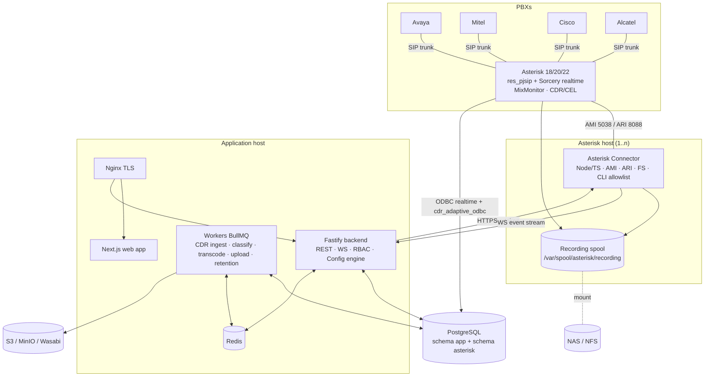

# 01 — System Architecture

Echelons Call Recording Platform is a management and recording layer around one or more
Asterisk servers that sit between customer PBXs (Avaya, Mitel, Cisco, Alcatel, …) and their
SIP carriers or each other. Every PBX connects to Asterisk using a SIP trunk. Asterisk records
calls with MixMonitor and writes CDR/CEL to the database. The platform manages Asterisk
configuration through PJSIP + Sorcery Realtime.

## 1. Core principles

| # | Principle | Consequence |
|---|-----------|-------------|
| P1 | **The database is the source of truth. Asterisk only reads a published copy.** | Admins edit *draft* objects in the `app` schema. A publish step writes them to the Asterisk realtime tables (`asterisk.ps_*`) in a single transaction. |
| P2 | **Calls must keep working when the web platform is down.** | Routing and recording decisions are compiled into the Asterisk dialplan. Asterisk never calls back into Node while a call is being set up. |
| P3 | **Only the connector talks to Asterisk.** | The backend never opens AMI/ARI sockets or touches `/etc/asterisk`. The connector runs on the Asterisk host and exposes an authenticated internal API. |
| P4 | **Every change goes through the configuration pipeline.** | validate → snapshot → save → publish → reload → verify → (rollback) → audit. Nothing skips it. |
| P5 | **Classify calls after the call, not during it.** | The routing decision (route ID, recording policy) is stamped onto the channel by the dialplan. The full rule engine runs when the CDR is ingested, so call types can be reclassified later. |
| P6 | **Branding is configuration.** | Product name, logo and colours live in `system_settings` and env vars. The code never contains the string "Echelons". |

## 2. Component diagram



## 3. Monorepo layout

```
apps/
  backend/      Fastify API, configuration engine, workers, Prisma schema
  connector/    Asterisk connector (AMI, ARI, CLI allowlist, file ops, event stream)
  web/          Next.js (App Router) UI
packages/
  shared/       Pure TypeScript domain logic shared by all apps:
                permissions, route-pattern engine, classification engine,
                PJSIP parameter catalog, dialplan compiler, zod DTOs
deploy/
  asterisk/     sorcery.conf, extconfig.conf, res_odbc.conf, cdr_adaptive_odbc.conf,
                extensions.conf include stubs, manager.conf/ari.conf templates
  nginx/        reverse proxy
  systemd/      unit files
  scripts/      install.sh, backup.sh, db bootstrap SQL
docs/           this document set
```

## 4. Backend module map (Configuration Service)

```
ConfigurationService (pipeline + versioning + audit)
 ├── PjsipManager       endpoints, aors, auths, identifies, transports, registrations
 ├── SorceryManager     object→wizard mapping, realtime table health, cache
 ├── TrunkManager       PBX connection → composite (endpoint+aor+auth+identify[+registration])
 ├── RouteManager       routes, route patterns, prefix/strip/prepend
 ├── DialplanManager    contexts/extensions → compiled extensions_echelons.conf
 ├── RecordingManager   recording policies → dialplan Gosub + MixMonitor options
 └── AsteriskCliManager allowlisted CLI via connector
```

Other backend modules: `auth`, `users`, `rbac`, `calls`, `cdr`, `recordings`, `storage`,
`retention`, `reports`, `export`, `monitoring`, `audit`, `backup`, `setup` (first-run wizard),
`import` (discover existing Asterisk config), `classification`.

## 5. Asterisk version abstraction

The connector runs `core show version` when it connects and reports `{major, minor, patch}`.
`packages/shared/src/pjsip/catalog.ts` lists every PJSIP option with the versions it is valid
in (`since`, `removedIn`) and its value type. Validation rejects options that are unknown or not
supported by the target server's version **before** anything is published. Custom parameters are
allowed if they are in the catalog. With `strictCatalog=false` on a server, unknown options can
be forced through, but only after the admin explicitly acknowledges the warning.

## 6. Scaling

* CDR and call tables are range-partitioned by month on `start_time` (see doc 02). Indexes match the search filters.
* Lists use keyset (cursor) pagination on `(start_time DESC, id)`.
* Audio is always streamed with HTTP Range support and never buffered in memory.
* Heavy work (CDR normalisation, MP3 transcoding, S3 upload, retention, exports) runs in BullMQ workers.
* Multiple Asterisk servers: one connector per server, and each is registered as an `asterisk_servers` row bound to a site.

## 7. Development phases

The 16 phases in the requirements are followed in order. Each phase ends with a check against a
real Asterisk 20/22 lab server (see doc 04 §8, "Lab verification").
