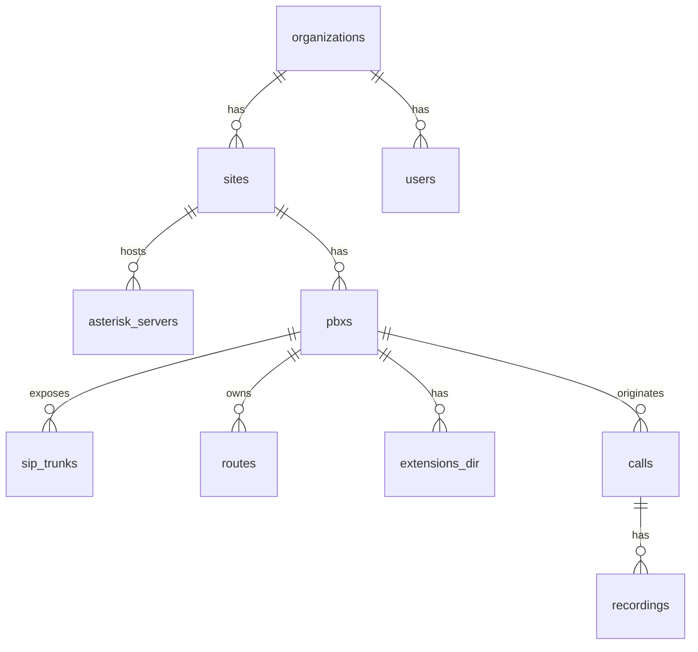
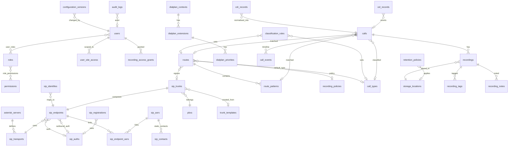

# 02 — Database Design & ERD

PostgreSQL 16, two schemas:

* **`app`** is managed by Prisma. It holds every application entity, uses UUID primary keys (`gen_random_uuid()`), and is tenant-scoped.
* **`asterisk`** holds the tables Asterisk reads through ODBC: the Sorcery realtime `ps_*` tables, `extensions` (unused by default), `cdr` and `cel`. These follow **Asterisk's own column contract** (text `id` primary keys, Asterisk column names) because Asterisk requires it. They are written only by the publish step and by Asterisk itself.

The full definition is in [`apps/backend/prisma/schema.prisma`](../apps/backend/prisma/schema.prisma).

## 1. Tenancy hierarchy

Every tenant-sensitive table has `organization_id`, and where it applies, `site_id`.
Isolation is enforced in two layers:

1. **Backend.** Every repository call goes through `tenantScope(req)`, which adds `organization_id` (and site restrictions for site-scoped users) to the `where` clause. Prisma client extensions reject queries on tenant tables that are missing the scope.
2. **Database.** Row-Level Security is enabled on tenant tables. Policies compare `organization_id` with `current_setting('app.org_id')`, which the backend sets per transaction (`SET LOCAL`). The `echelons_app` DB role is not a superuser and does not have `BYPASSRLS`. Workers use a dedicated role that also does not bypass RLS, and they set the org per job.

## 2. Core ERD

## 3. Table groups

| Group | Tables |
|-------|--------|
| Identity | `organizations`, `sites`, `users`, `roles`, `permissions`, `role_permissions`, `user_roles`, `user_site_access`, `refresh_tokens`, `mfa_factors` |
| Telephony infra | `asterisk_servers`, `pbxs`, `trunk_templates`, `sip_trunks` |
| PJSIP (drafts) | `sip_transports`, `sip_endpoints`, `sip_aors`, `sip_endpoint_aors`, `sip_auths`, `sip_contacts`, `sip_identifies`, `sip_registrations`, `sip_domain_aliases`, `sip_globals`, `sorcery_mappings` |
| Routing | `routes`, `route_patterns`, `call_types`, `classification_rules`, `recording_policies` |
| Dialplan | `dialplan_contexts`, `dialplan_extensions`, `dialplan_priorities` |
| Calls | `cdr_records`, `cel_records`, `calls`, `call_events`, `extensions_dir` (agent/extension/department directory) |
| Recordings | `recordings`, `recording_tags`, `recording_notes`, `recording_access_grants`, `storage_locations`, `retention_policies`, `retention_runs` |
| Governance | `audit_logs`, `configuration_versions`, `config_apply_jobs`, `backups`, `system_settings` |
| Asterisk contract (schema `asterisk`) | `ps_endpoints`, `ps_aors`, `ps_auths`, `ps_contacts`, `ps_domain_aliases`, `ps_endpoint_id_ips`, `ps_globals`, `ps_systems`, `ps_registrations`, `ps_transports` (stored, but reloaded only on restart), `cdr`, `cel` |

## 4. Draft → published mapping

| `app` table | `asterisk` table | Key | Notes |
|-------------|------------------|-----|-------|
| sip_endpoints | ps_endpoints | `name` | `aors`/`auth`/`outbound_auth` are resolved to names |
| sip_aors (+ sip_contacts) | ps_aors | `name` | static contacts are written to `ps_aors.contact` (comma list) |
| sip_auths | ps_auths | `name` | the password is decrypted only inside the publish transaction |
| sip_identifies | ps_endpoint_id_ips | `name` | `match` is a comma list of IP/CIDR/host |
| sip_registrations | ps_registrations | `name` | needs `res_pjsip_outbound_registration` realtime mapping |
| sip_domain_aliases | ps_domain_aliases | `name` | |
| sip_globals | ps_globals | `global` | singleton |
| sip_transports | ps_transports **or** `pjsip_echelons_transports.conf` | `name` | transports cannot be hot-reloaded and need a restart — see doc 05 §4 |

Every draft row has `server_id`, `published_version`, `draft_hash` and `published_hash`.
The UI shows a **pending changes** badge when `draft_hash ≠ published_hash`.

## 5. Indexes (call/recording search)

`calls`:
* `(organization_id, start_time DESC, id)` is the main keyset index.
* `(organization_id, caller_number, start_time DESC)` and `(organization_id, destination_number, start_time DESC)`.
* `uniqueid` is UNIQUE per server. There is also an index on `linkedid`.
* `(organization_id, pbx_id, start_time DESC)`, `(trunk_id, start_time)`, `(route_id, start_time)`, `(route_pattern_id, start_time)`.
* `(organization_id, call_type_id, start_time DESC)` and `(organization_id, direction, start_time DESC)`.
* GIN `pg_trgm` on `caller_number` and `destination_number` for partial-number search (created in a SQL migration).

`recordings`: `(organization_id, started_at DESC)`, `call_id`, `(storage_location_id, retention_expires_at)` for cleanup.

`cdr_records` / `calls` also get a BRIN index on `start_time`, which is cheap at any size. The raw SQL
migration `prisma/sql/001_rls_trgm.sql` enables RLS, `pg_trgm` and the BRIN/trigram indexes.

**Partitioning (above roughly 50M calls).** A declaratively partitioned table needs the partition
key in every unique key and FK. Because of that, the app keeps `calls.id` as the only key
and moves *cold* months into `calls_archive_YYYYMM` tables with the same columns, using the
`archive-calls` worker. Search unions the archive tables only when the date filter reaches them.
This keeps Prisma relations intact and still caps the hot table size.
