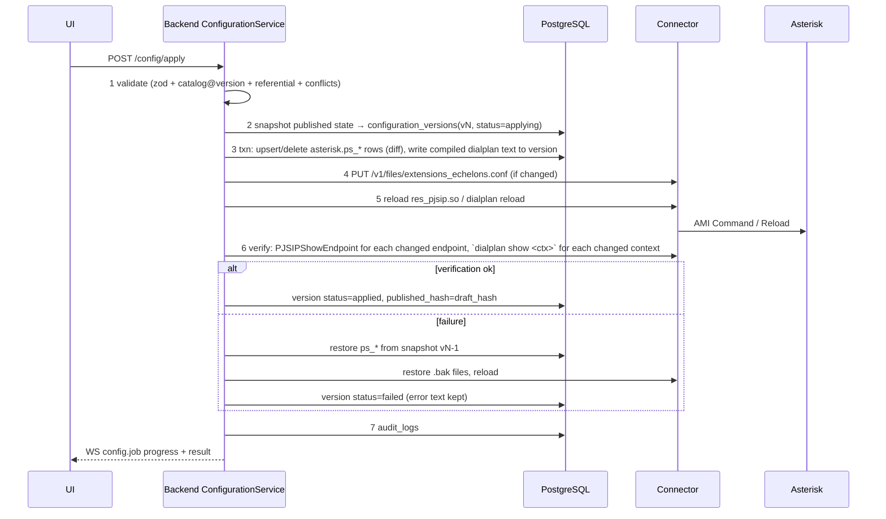

# 04 — Asterisk Integration Architecture

## 1. Integration surfaces

| Surface | Used for | Owner |
|---|---|---|
| **ODBC realtime (Sorcery)** | PJSIP objects read by Asterisk from `asterisk.ps_*` | publish step (backend, in a DB transaction) |
| **cdr_adaptive_odbc / cel_odbc** | Durable CDR/CEL rows in `asterisk.cdr` / `asterisk.cel` | Asterisk |
| **AMI (TCP 5038)** | Reloads, `PJSIPShow*`, `CoreShowChannels`, `Command` (allowlisted), live events (Newchannel, Hangup, BridgeEnter, VarSet filtered, MixMonitorStart/Stop, ContactStatus, Registry, DeviceStateChange) | connector |
| **ARI (HTTP/WS 8088)** | `GET /asterisk/info`, `/asterisk/modules`, `/endpoints`, `/channels`, `/bridges` (read-only inventory); test-call origination into `echelons-test` Stasis app | connector |
| **Filesystem** | Writes `extensions_echelons.conf`, `pjsip_echelons_transports.conf`; reads recordings, `/var/log/asterisk/messages` (tail) | connector |

The backend never opens any of these. It talks to the connector over HTTPS with a shared bearer token
(`CONNECTOR_TOKEN`), and the connector listens only on localhost or the management VLAN.

## 2. Connector internals

```
connector
 ├── ami/AmiClient           TCP framing, ActionID correlation, login, keepalive Ping,
 │                           exponential back-off reconnect (1s→30s), event emitter
 ├── ari/AriClient           fetch-based REST + /ari/events WebSocket
 ├── queue/CommandQueue      serialises reloads / file writes (one at a time per server),
 │                           per-command timeout, result promise
 ├── cli/Allowlist           regex allowlist; dangerous verbs rejected (doc 08 §6)
 ├── config/FileWriter       atomic write (tmp + fsync + rename), .bak retention, sha256
 ├── version/VersionProbe    `core show version` → {major, minor, patch, certified}
 ├── events/EventBridge      AMI/ARI events → normalised live-call model → WS to backend
 └── http/server             Fastify, routes under /v1/*, token auth, health
```

### Connector API (internal)
| Method | Path | Purpose |
|---|---|---|
| GET | /v1/health | AMI/ARI connected, version, uptime |
| POST | /v1/ami/action | whitelisted AMI actions only (`PJSIPShowEndpoint`, `PJSIPShowEndpoints`, `PJSIPShowRegistrationsOutbound`, `PJSIPShowContacts`, `PJSIPQualify`, `CoreShowChannels`, `BridgeList`, `ModuleCheck`, `ModuleLoad(reload)`, `CoreStatus`, `CoreSettings`) |
| POST | /v1/cli | allowlisted CLI command |
| POST | /v1/reload | `{module}` from a fixed set (`res_pjsip.so`, `pbx_config.so`, `cdr`, `res_pjsip_outbound_registration.so`) |
| PUT | /v1/files/:name | write a managed config file (names limited to `extensions_echelons.conf`, `pjsip_echelons_transports.conf`) with backup |
| POST | /v1/files/:name/restore | restore previous `.bak` |
| GET | /v1/recordings/stat?path | file existence/size/mtime (path confined to `RECORDING_BASE_PATH`) |
| GET | /v1/recordings/stream?path | range stream (used when the backend is not on the same host) |
| DELETE | /v1/recordings?path | delete (confined path) |
| GET | /v1/system | CPU, RAM, disk, load (from `/proc` and `statfs`) |
| GET | /v1/net/check?host&port&proto | DNS + TCP/UDP reachability probe |
| POST | /v1/test-call | ARI originate to `Local/<number>@<context>` with timeout |
| WS | /v1/events | normalised event stream to the backend |

## 3. Apply pipeline (per server)



Asterisk cannot dry-run a realtime PJSIP reload, so **step 1 does the real validation**:
* zod type and range checks, enum values, and the IP/CIDR format.
* Catalog check: is the option known, and is it supported for the server's major version?
* Referential checks: the endpoint's transport exists, every AOR/auth exists, the identify points to an existing endpoint, and the context exists in the compiled dialplan or is listed as an external context.
* Conflict checks: duplicate identify matches across endpoints, overlapping route patterns at the same priority, and transport port clashes.

Verification in step 6 then catches anything Asterisk rejects at runtime. Asterisk logs a
sorcery/realtime parse error and the object goes missing from `PJSIPShowEndpoint`. When that
happens, the step rolls back.

## 4. Dialplan strategy

The dialplan is **compiled into a file**, not served through realtime `switch =>`, because:
* compiled contexts reload atomically (`dialplan reload`) and can be checked with `dialplan show`.
* there are no per-call database lookups, so calls keep working if PostgreSQL is degraded.

`/etc/asterisk/extensions.conf` contains only `#include extensions_echelons.conf` plus any
hand-written legacy contexts, which keep working. Generated contexts all start with
a configurable prefix (default none) and are fenced by a header comment holding the version and hash.

## 5. Recording invocation

Every inbound PBX context generated for a trunk calls:

```
same => n,Gosub(echelons-route,s,1(${EXTEN}))
```

`echelons-route` is the compiled route table. Each route pattern becomes an extension in a
per-PBX context that sets `ECH_ROUTE_ID`, `ECH_ROUTE_PATTERN_ID`, `ECH_DIRECTION` and `ECH_REC_POLICY`, applies
strip/prepend, and then `Gosub(echelons-record,s,1)` → `MixMonitor(...)`.
See doc 07 for details.

## 6. CDR linkage

Custom CDR variables are set with `Set(CDR(ech_route_id)=…)` and similar calls. `cdr_adaptive_odbc` writes
any CDR variable whose name matches a column. The `asterisk.cdr` table therefore has the extra columns
`ech_pbx_id, ech_trunk_id, ech_route_id, ech_route_pattern_id, ech_direction, ech_rec_file,
ech_rec_policy, ech_server_id, sip_callid, peer_ip, user_agent`.

The `cdr-ingest` worker reads `asterisk.cdr` by its `seq` (bigserial) watermark. It is idempotent
because of the unique key `(server_id, uniqueid, seq)`. It creates or updates `app.cdr_records` and `app.calls`
(grouped by `linkedid`), runs the classification engine, and links recordings.

## 7. Version compatibility

| Feature | 18 | 20 | 22 |
|---|---|---|---|
| ps_* realtime schema | alembic up to 18 | +columns (e.g. `security_negotiation`) | +columns |
| `PJSIPShowRegistrationsOutbound` | ✓ | ✓ | ✓ |
| identify `match_request_uri` | ✗ | ✓ (20.6+) | ✓ |
| `google_oauth` auth type | ✓ (if built with) | ✓ | removed in 22 for some builds → catalog marks `removedIn` |
| `dialplan reload` via AMI Command | ✓ | ✓ | ✓ |

The catalog (`packages/shared/src/pjsip/catalog.ts`) is the single source for these rules.

## 8. Lab verification

`deploy/scripts/lab-verify.sh` checks a real server after install:
1. The connector `/v1/health` reports AMI and ARI connected.
2. A test endpoint is created through the API, applied, and confirmed with `pjsip show endpoint`.
3. A route pattern is created and applied, then confirmed with `dialplan show echelons-route-*`.
4. An ARI test call to `Local/` records audio, and the CDR then shows up in `/api/calls`.
