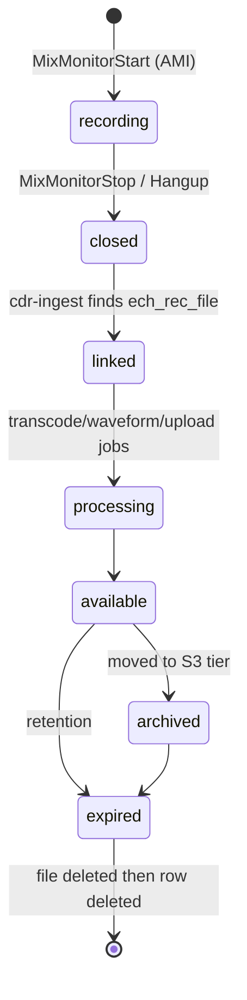

# 07 — Recording Architecture

## 1. Policies

`recording_policies` rows (configurable):

| Field | Values |
|---|---|
| mode | `NEVER`, `ALWAYS`, `INBOUND_ONLY`, `OUTBOUND_ONLY`, `ON_DEMAND` |
| layout | `MIXED`, `MIXED_AND_SPLIT` (mixed + separate caller/callee legs via `r()`/`t()`; MixMonitor always writes the mixed file, so a split-only layout is not offered) |
| format | `wav`, `wav49`, `gsm` (native MixMonitor) |
| post_formats | `[]`, `['mp3']` (worker transcodes with ffmpeg) |
| keep_original | bool (when false the WAV is deleted after a verified MP3) |
| storage_location_id | target storage |
| beep / announce | optional periodic beep `B(n)` |

The effective policy is resolved in this order: route-pattern override → route → trunk → PBX → org default.
This resolution happens **at compile time**, so each generated route extension carries its final policy code.

## 2. MixMonitor invocation

```ini
[ech-record]
exten => s,1,GotoIf($["${ARG1}" = "NEVER"]?done)
 same => n,Set(ECH_TS=${STRFTIME(${EPOCH},,%Y%m%d-%H%M%S)})
 same => n,Set(ECH_DIR_PATH=${STRFTIME(${EPOCH},,%Y/%m/%d)}/${ECH_PBX_NAME})
 same => n,Set(ECH_BASE=${ECH_DIR_PATH}/${ECH_TS}_${FILTER(0-9+,${CALLERID(num)})}_${FILTER(0-9+*#,${ECH_NUM})}_${ECH_DIRECTION})
 same => n,Set(CDR(ech_rec_file)=${ECH_BASE})
 same => n,Set(CDR(ech_rec_policy)=${ARG1})
 same => n,MixMonitor(${ECH_BASE}.${ECH_FMT},b${ECH_SPLIT_OPTS})
 same => n(done),Return()
```

* `b` records only after the call is bridged, so ringing is not recorded.
* For split layout, `ECH_SPLIT_OPTS` is `r(${ECH_BASE}-caller.${ECH_FMT})t(${ECH_BASE}-callee.${ECH_FMT})`.
* `FILTER()` removes anything except digits from caller ID before it goes into the path, which blocks path injection.
* Relative paths are resolved by Asterisk under `astspooldir/monitor`. `RECORDING_BASE_PATH` is set so that `[directories] astspooldir` + `/monitor` is a symlink to it, or the absolute base is prepended at compile time (the default; configurable per server).

Example: `2026/11/16/AVAYA/20261116-225501_971501234567_971509876543_OUTBOUND.wav`.

## 3. Lifecycle



* **Live.** The connector maps the AMI `MixMonitorStart`/`Stop` events (Asterisk 20+; on 18 it falls back to `VarSet` of `MIXMONITOR_FILENAME`) to `recording.started` / `recording.stopped`.
* **Linking.** `recordings.call_id` is set from the CDR's `ech_rec_file` plus `linkedid`. If the file is not there yet, the worker retries with back-off for up to 10 minutes and then flags `missing_file`.
* **Metadata.** Everything in spec §18 is either a column on `recordings` or comes from the joined `calls` row. Agent, department, queue and campaign come from the `extensions_dir` directory and the CDR `accountcode`/`userfield`.

## 4. Storage drivers

`StorageDriver` interface: `stat, createReadStream(range), delete, put(stream), presign?, usage()`.

| Driver | Notes |
|---|---|
| `local` | path confined to the base directory (realpath check), `statfs` for usage |
| `nfs` / `nas` | same as local, but on a mounted path. A health check writes and deletes a probe file |
| `s3` | AWS SDK v3 with a custom endpoint (MinIO/Wasabi). Multipart upload and presigned GET (≤ 300 s). Secrets are encrypted in `storage_locations.secret_enc` |

Streaming: `GET /api/recordings/:id/stream` checks auth, permission and the access grant, then pipes
`createReadStream({start,end})` with `206 Partial Content`. Files are never served from a static
directory, and Nginx has `location /recordings` deny-all as a safety net.

## 5. Waveform

The `waveform` worker computes 1,000 peak buckets per channel with ffmpeg (decoded to s16le) and caches
them as JSON in `recordings.waveform`. The player draws them on canvas, so the browser does not decode the whole file.

## 6. Retention & cleanup

`retention_policies` match on `pbx_id?, call_type_id?, route_id?, department?, layout?` and set
`keep_days | null (unlimited)`. When several policies match, the **longest** keep wins (safe default).
`retention_expires_at` is calculated when the recording is linked and recalculated when policies change.

Cleanup job (`retention-run`):
1. Select recordings with `retention_expires_at < now()` and `legal_hold = false`, in batches of 500.
2. Re-check the policy (in case it changed since the expiry was calculated).
3. `stat` the file. If it is missing, mark it `missing_file` and leave the row for review (not deleted).
4. Delete the file(s). **Only after success**, delete the metadata in a transaction and write an audit row.
5. Dry-run mode does steps 1–3 and writes a `retention_runs` report without deleting anything.
